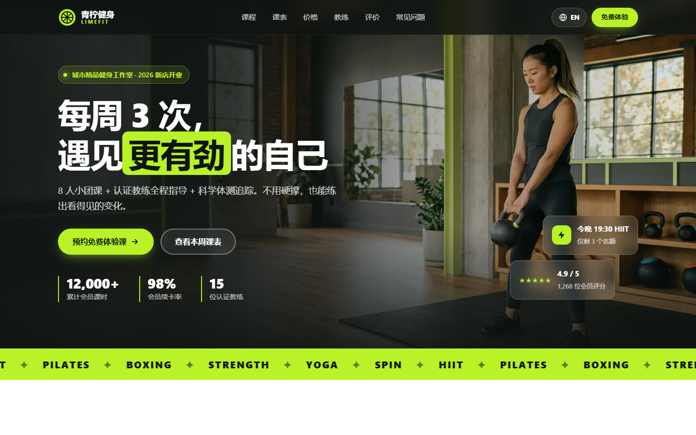
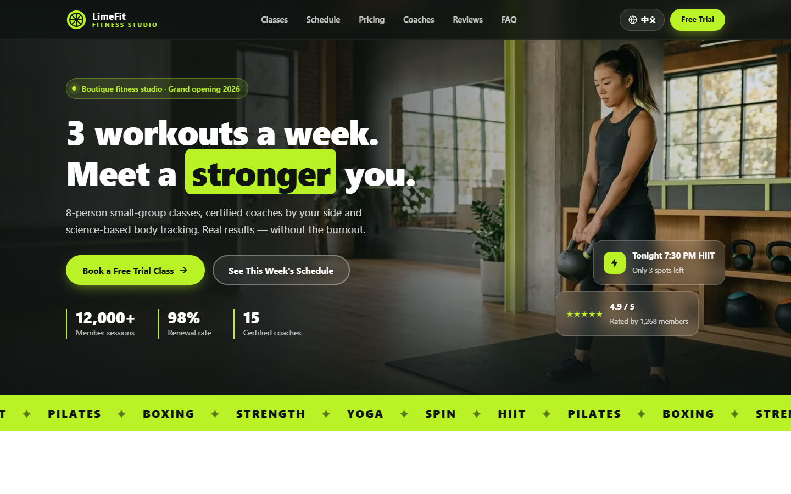
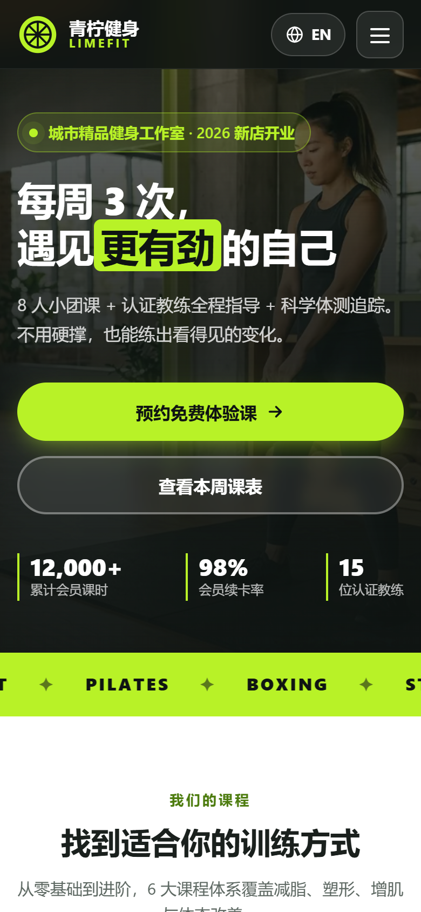
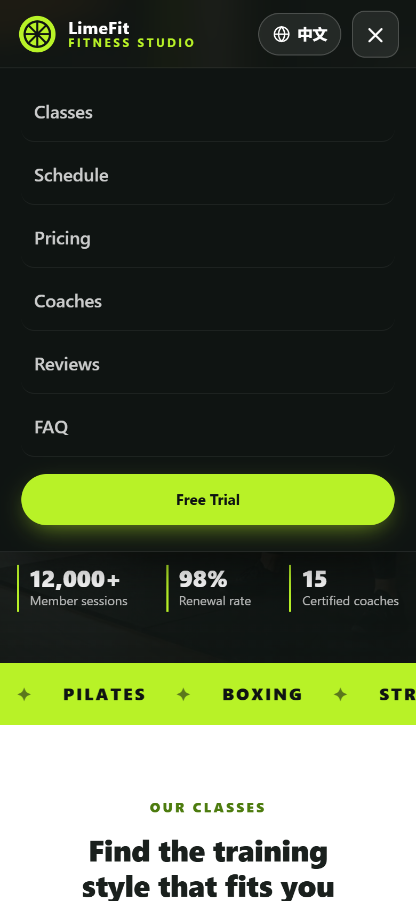
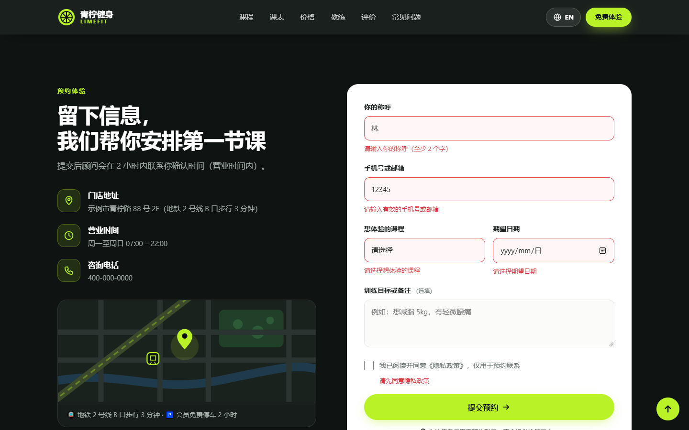
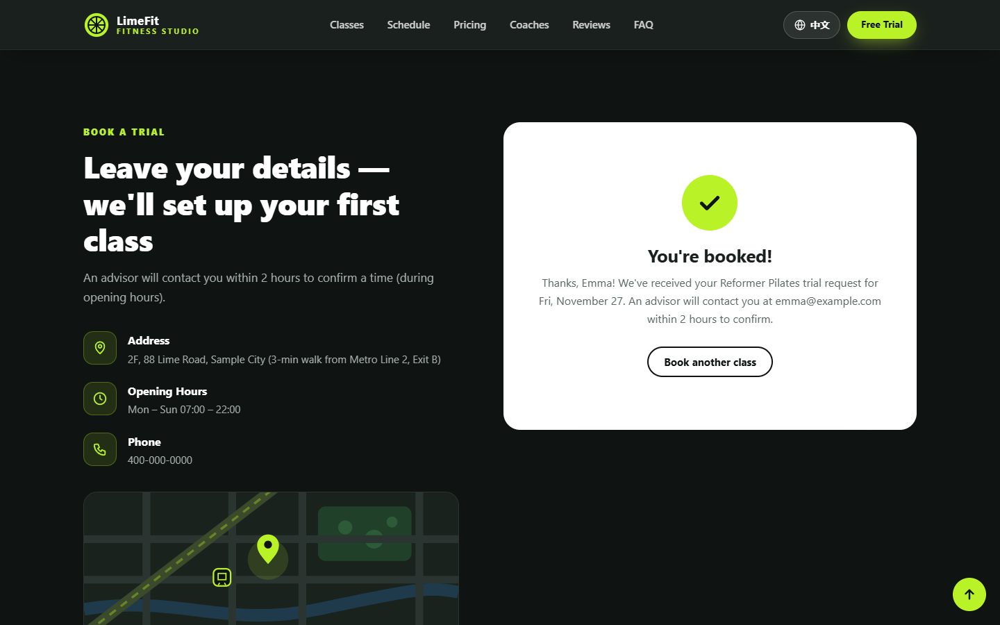
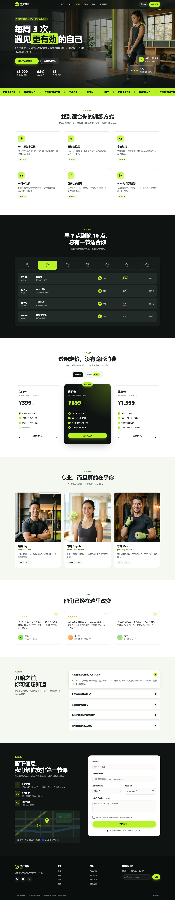

# LimeFit 青柠健身 — Bilingual Business Landing Page

**🌐 Live demo / 在线演示：** [https://limarkss.github.io/limefit-landing-page/](https://limarkss.github.io/limefit-landing-page/) · English: [https://limarkss.github.io/limefit-landing-page/?lang=en](https://limarkss.github.io/limefit-landing-page/?lang=en)

> A fast, responsive, bilingual (中文 / English) marketing website for a **fictional** boutique fitness studio.
> Built with **pure HTML + CSS + vanilla JavaScript** — zero frameworks, zero CDNs, zero external fonts.
>
> 一个为**虚构**精品健身工作室打造的响应式中英双语企业官网 / 落地页，纯原生 HTML + CSS + JS 实现，无任何外部依赖，国内访问秒开。



---

## English

### ✨ Features

| Area | What's included |
|---|---|
| **Layout** | Sticky blurred header, full-bleed hero with strong CTAs, animated marquee strip, services grid, weekly class schedule, 3-tier pricing (highlighted middle plan), coach team, testimonials, FAQ, booking form, footer |
| **Responsive** | Desktop → tablet → mobile (tested at 1440 px and 390 px). Mobile hamburger menu with animated icon, Esc-to-close, click-outside-to-close |
| **i18n** | One-click 中文 / English toggle using a `data-i18n` attribute system. Translates text, placeholders, `alt`, `aria-label`, `<title>`, meta description and `<html lang>`. **Currency is localized too** (¥ CNY ↔ $ USD). Choice is saved in `localStorage`; `?lang=en` deep-links work; first visit auto-detects browser language |
| **Interactive** | Day-tab class schedule (keyboard arrow navigation, ARIA tabs), monthly / yearly billing toggle, accessible FAQ accordion, "Choose plan" pre-fills the booking note, back-to-top button, active-section nav highlighting |
| **Booking form** | Client-side validation (name, CN mobile / international phone / email, class, date range: today → +60 days, consent checkbox), inline bilingual error messages, `aria-invalid` + `aria-live`, shake feedback, loading state, personalized success message |
| **Motion** | Scroll-reveal via `IntersectionObserver`, floating hero cards, hover lifts. Respects `prefers-reduced-motion`; content is never hidden without JS (`.js` class gate); elements already in view are revealed instantly |
| **Accessibility** | Semantic landmarks (`header / nav / main / section / footer`), skip link, visible `:focus-visible` styles, labelled inputs, alt text, sufficient color contrast |
| **SEO** | Meta description & keywords, canonical, `hreflang` alternates, Open Graph + Twitter Card (1200×630 cover image), JSON-LD `HealthClub` structured data |
| **Performance** | No external requests, system font stack, WebP images with JPEG fallback (all < 140 KB), explicit `width/height` (no layout shift), lazy-loaded below-the-fold images, preloaded hero, deferred scripts |

### 🛠 Tech

- HTML5 · CSS3 (custom properties, Grid, Flexbox, `clamp()`, `backdrop-filter`, `:has()`) · Vanilla ES5+ JavaScript
- Inline SVG icons & illustrations (no icon fonts)
- AI-generated photography of fictional people, compressed with Pillow

```
02-企业官网落地页/
├── index.html          # All markup — Chinese copy is the source of truth (SEO friendly)
├── css/style.css       # Design tokens, layout, components, responsive rules
├── js/i18n.js          # English dictionary + JS-only strings for both languages
├── js/main.js          # Nav, i18n engine, schedule, pricing, accordion, form, reveal
├── assets/             # hero / coach photos (.webp + .jpg), og-cover.jpg, favicon.svg
└── screenshots/        # Preview images
```

### 👀 How to view

Just double-click **`index.html`** — it runs straight from the file system, no build step and no server needed.

- English version: open `index.html?lang=en` (or click the **EN** button in the header)
- Static mode without animations (for print / screenshots): `index.html?static=1`

### 🚀 How to deploy

It's a plain static site — upload the folder to any static host:

- **China**: Alibaba Cloud OSS, Tencent Cloud COS, Qiniu, Gitee Pages, or any Nginx server
- **Global**: Netlify (drag & drop), Vercel, GitHub Pages, Cloudflare Pages

Before going live, replace `https://www.limefit.example/` in the `<head>` meta tags with your real domain, and connect the form in `js/main.js` (search for `Simulated request`) to your backend, Formspree, or a WeChat Work / DingTalk / Feishu webhook.

### 📸 Screenshots

| Desktop (EN, above the fold) | Mobile (ZH, above the fold) | Mobile menu (EN) |
|---|---|---|
|  |  |  |

| Form validation (ZH) | Booking success (EN) |
|---|---|
|  |  |

Full-page captures:
[Desktop 1440 – 中文](screenshots/desktop-full-zh.png) ·
[Desktop 1440 – English](screenshots/desktop-full-en.png) ·
[Mobile 390 – 中文](screenshots/mobile-full-zh.png)

<details>
<summary>Show full-page desktop screenshot</summary>


</details>

<details>
<summary>Show full-page mobile screenshot</summary>


</details>

### 🎯 Can be customized for

Restaurants & cafés · clinics (dental, medical aesthetics, physiotherapy) · yoga / dance / music studios · beauty salons · education & training centers · SaaS products & apps · real estate · law / consulting firms · personal brands & portfolios · event landing pages.

Typical customization: your brand colors (edit the CSS variables at the top of `style.css`), your copy & photos, extra languages (copy the `en` block in `i18n.js`), and form delivery to email / WeChat / CRM.

> ⚠️ "青柠健身 LimeFit" is a fictional brand created for this portfolio demo. All people in the photos are AI-generated and fictional; address and phone numbers are placeholders.

---

## 中文

### ✨ 功能亮点

| 模块 | 内容 |
|---|---|
| **页面结构** | 毛玻璃吸顶导航、全屏大图首屏 + 强转化按钮、滚动字幕条、课程服务、本周课表、三档价格卡（中间档高亮推荐）、教练团队、会员评价、FAQ 手风琴、预约表单、页脚 |
| **响应式** | 桌面 / 平板 / 手机全适配（1440 与 390 宽度实测）；手机端汉堡菜单，支持 Esc 与点击空白处关闭 |
| **中英双语** | 基于 `data-i18n` 属性的一键切换，覆盖正文、占位符、图片 alt、无障碍标签、网页标题、meta 描述与 `<html lang>`；**价格货币同步切换**（¥ 人民币 ↔ $ 美元）；记住用户选择，支持 `?lang=en` 直达英文版，首次访问自动识别浏览器语言 |
| **交互** | 按日期切换的课表（支持键盘左右键、ARIA 标签页语义）、月付 / 年付切换、无障碍 FAQ 手风琴、点击"选择此方案"自动填写备注、回到顶部、导航随滚动高亮当前板块 |
| **预约表单** | 前端校验（称呼、国内手机号 / 国际号码 / 邮箱、课程、日期范围限今天起 60 天内、隐私勾选），中英文错误提示即时显示，`aria-invalid` + `aria-live` 读屏友好，错误抖动反馈、提交加载态、个性化成功提示 |
| **动效** | `IntersectionObserver` 滚动渐显、首屏浮动卡片、悬停上浮；尊重系统"减少动态效果"设置；无 JS 时内容依旧完整可见，首屏元素立即显示不留白 |
| **无障碍** | 语义化标签、跳转到主要内容链接、清晰的键盘焦点样式、表单标签关联、图片替代文本、色彩对比度达标 |
| **SEO** | meta 描述与关键词、canonical、hreflang 多语言声明、Open Graph / Twitter 分享卡片（1200×630 封面图）、JSON-LD 结构化数据 |
| **性能** | 零外部请求（国内秒开）、系统字体栈、WebP + JPEG 兜底（单张 < 140 KB）、图片声明宽高避免布局抖动、首屏外图片懒加载、首图预加载、脚本 defer |

### 🛠 技术栈

HTML5 · CSS3（CSS 变量、Grid、Flexbox、clamp、backdrop-filter、:has）· 原生 JavaScript · 内联 SVG 图标与插画 · AI 生成的虚构人物照片（Pillow 压缩）

### 👀 如何查看

直接双击打开 **`index.html`** 即可，无需安装、无需构建、无需服务器。

- 英文版：打开 `index.html?lang=en`，或点击右上角 **EN** 按钮
- 无动画静态模式（打印 / 截图用）：`index.html?static=1`

### 🚀 如何部署

纯静态网站，上传整个文件夹到任意静态托管即可：

- **国内**：阿里云 OSS、腾讯云 COS、七牛云、Gitee Pages、任意 Nginx 服务器
- **海外**：Netlify（拖拽上传）、Vercel、GitHub Pages、Cloudflare Pages

上线前请把 `<head>` 中的 `https://www.limefit.example/` 替换为真实域名，并在 `js/main.js` 中（搜索 `Simulated request`）将表单对接到你的后端、邮箱服务或企业微信 / 钉钉 / 飞书机器人。

### 📸 截图

见上方英文部分的截图表格，或直接打开 `screenshots/` 文件夹：

- `desktop-full-zh.png` / `desktop-full-en.png` — 桌面端 1440 宽整页（中 / 英）
- `mobile-full-zh.png` — 手机端 390 宽整页
- `mobile-hero-zh.png` / `mobile-hero-en.png` — 手机端首屏（390×844 @2x）
- `desktop-hero-zh.png` / `desktop-hero-en.png` — 桌面端首屏
- `mobile-menu-en.png` — 手机端展开菜单
- `form-validation-zh.png` / `form-success-en.png` — 表单校验与提交成功

### 🎯 可定制行业

餐厅 / 咖啡馆 · 诊所（口腔、医美、康复理疗）· 瑜伽 / 舞蹈 / 音乐工作室 · 美容美发 · 教育培训机构 · SaaS 产品 / App 官网 · 房产 · 律所 / 咨询公司 · 个人品牌与作品集 · 活动落地页等。

常见定制：更换品牌色（修改 `style.css` 顶部 CSS 变量）、替换文案与图片、增加更多语言（复制 `i18n.js` 中的 `en` 块翻译即可）、表单对接邮箱 / 微信 / CRM。

> ⚠️ "青柠健身 LimeFit" 为作品集演示用的虚构品牌，图片中人物均为 AI 生成的虚构形象，地址与电话均为占位信息。
